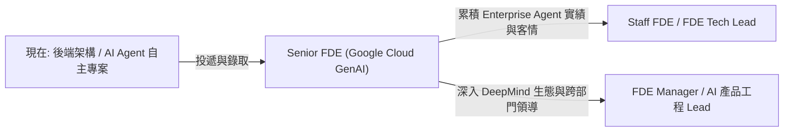

# Google - Senior Forward Deployed Engineer, Generative AI, Google Cloud (Mandarin)

> ## 評估摘要 (Evaluation Summary)
>
> `評估日期`: 2026-09-22, 對照 [Resume.md](../../Resume.md)
>
> `匹配度 (Profile Matching Score)`: `73 / 100`
>
> `結論`: `Google Cloud 體系中與履歷現況最契合的一線 AI 實戰崗位`. 相比同團隊的 [Manager 檔 (58 分)](forward_deployed_engineering_manager.google_cloud_ai.md), 本檔為資深 IC, 5 年門檻遠低於履歷年資, 且流暢中文要求形成強大地緣護城河. 履歷在 Agent SDK, 多模型協同 (Multi-agent / MCP) 與 MLOps 推論排程上的深度直接命中加分項; 唯一主要缺口在於面向外部企業客戶的正式交付紀錄與 Vertex AI / GCP 大規模生產驗證.
>
> `符合的部分`:
>
> - `資訊工程相關學士學位或同等實務經驗`: 國立中央大學資工碩士, 國立東華大學資工學士.
> - `5 年以上 Python 或類似程式語言軟體開發經驗`: 12+ 年軟體開發經驗 (Python, Golang, Java, JavaScript).
> - `在雲端平台上架構 AI 系統的經驗`: TSMC AI 平台架構, Kubernetes / MLOps GPU 推論排程器, 跨八家模型供應商的 Agent SDK, AWS Certified Solutions Architect.
> - `流暢中文 (Mandarin) 溝通以對接大中華區客戶`: 中文為母語, 具備 ByteDance 與 TSMC 跨兩岸技術協作與業務對齊深厚經驗.
> - `AI 或資工碩士學位 (加分)`: 完全命中 (資工碩士).
> - `實作 multi-agent 系統與複雜模式 (LangGraph, CrewAI, ADK, ReAct, self-reflection, hierarchical delegation) (加分)`: 自主研發通用 Agent SDK, 實作 multi-agent 協同, 工具調用與語音 agent 原型.
> - `理解 LLM 原生指標 (tokens/sec, cost-per-request) 與狀態管理, 細粒度追蹤 (加分)`: TSMC GPU 排程優化 (固定預算吞吐最大化) 與 Agent SDK 狀態追蹤架構直接對齊.
> - `主導技術發掘會議 (加分)`: ByteDance 跨部門架構推動, TSMC 技術專案管理與任務拆解.
>
> `不符合的部分`:
>
> - `將生產級 AI 驅動解決方案從構思推向客戶上線`: 履歷在 2026 年的 AI 交付為自研 Agent SDK 與原型專案, 過去大型系統交付 (ByteDance, TSMC) 均針對內部業務線而非外部合約客戶.
> - `向量資料庫與 RAG 企業級大規模管線`: 具備 RAG 與資料管線概念, 但缺乏生產環境大規模向量檢索庫 (如 Vertex AI Vector Search / Milvus) 的壓測與調優數據.
> - `GCP / Vertex AI 原生生態深度`: 主力雲端架構背景為 AWS, Azure 與自建 Kubernetes, GCP 實戰需在投遞前面試前補齊概念對齊.
>
> `投遞前必問`:
>
> - 大中華區客戶的對接模式, 新加坡出差頻率 (travel percentage) 與客戶現場駐點 (embed) 期望.
> - 交付方案是以 Google Cloud 託管的 Vertex AI / Gemini API 為主, 還是需深入客戶私有 VPC / 混合雲環境進行自建部署.
> - 內部產品工程與 DeepMind 的協作機制, FDE 反饋客戶痛點轉化為產品功能的標準渠道.
> - 團隊在新加坡目前配置與預計擴編規模.
> - Google 明確優先考慮具備新加坡合法工作權且不需簽證贊助者, 新加坡 PR 身份直接滿足.

## 基本資訊 (Basics)

| 項目 | 內容 |
| --- | --- |
| 公司 (Company) | Google (Alphabet) |
| 職稱 (Title) | Senior Forward Deployed Engineer, Generative AI, Google Cloud (Mandarin) |
| 部門 (Department) | Google Cloud / Go-To-Market (GenAI FDE) |
| 角色類型 (Role Type) | `ic` · `customer_facing` · `data_ai` |
| 地點 (Location) | 新加坡 (Singapore) |
| 職缺編號 (Job Post ID) | `84004648532222662` |
| 原始連結 (Original Link) | <https://www.google.com/about/careers/applications/jobs/results/84004648532222662-senior-forward-deployed-engineer/> |
| 薪酬 (Package) | 未公開 |
| 最低年資 (Min Experience) | `5 年以上` |
| 學歷要求 (Min Qualification) | 資訊工程或工程相關學士以上 |
| 投遞狀態 (Status) | `not_applied` (更新於 2026-09-22) |
| 抓取日期 (Fetched) | 2026-09-22 |
| 建立日期 (Created) | 2026-09-22 |

## 團隊背景 (Team Context)

本角色隸屬於 Google Cloud Go-To-Market (GTM) 體系中的 GenAI Forward Deployed Engineering 團隊. 團隊定位為具備創業者思維 (founder's mindset) 的前線實戰建造者 (innovator-builder), 區別於傳統諮詢或架構顧問角色, FDE 直接深入戰略客戶生產環境撰寫程式碼, 排除整合瓶頸, 資料整備問題與狀態管理挑戰, 推動客製化 agentic 方案落地. 同時扮演關鍵反饋迴圈, 將現場實踐痛點轉化為 Google Cloud 與 DeepMind 的產品功能與標準模組. 職位特別要求中文流利, 鎖定大中華區 (Greater China) 企業客戶與全球出海戰略帳戶.

## 崗位職責 (Responsibilities)

- 擔任複雜 AI 應用的核心開發者, 將概念驗證原型 (rapid prototypes) 轉化為生產級 agentic 工作流 (如 multi-agent 系統, MCP 伺服器), 創造可衡量的投資報酬 (ROI).
- 作為專家團隊一員, 架構並撰寫 Google AI 產品與客戶現有生產基礎設施 (包含 API, 既有資料孤島, 安全邊界) 之間的連接層 (connective tissue).
- 建置高效能評估管線 (evaluation pipelines) 與可觀測性框架 (observability frameworks), 確保 agentic 系統符合嚴苛的精準度, 安全性與延遲標準.
- 識別現場可重複的架構模式與 Google AI 技術棧摩擦點, 轉化為可複用模組或向內部工程團隊提出正式產品功能需求 (product feature requests).
- 與客戶工程團隊協同開發 (co-build), 傳授 Google 級別的開發最佳實踐, 確保長期專案成功與終端使用者高採用率. 向非技術背景與高階主管中文聽眾精準轉譯技術概念.

## 任職要求 (Requirements)

`硬性要求 (Must-have)` — 原文 `Minimum qualifications`:

- 工程, 資訊工程相關學士學位或同等實務經驗.
- `5 年` 以上使用 `Python` 或類似程式語言的軟體開發經驗.
- 在雲端平台 (如 `Google Cloud Platform (GCP)`) 上架構 AI 系統的經驗.
- 使用 `向量資料庫 (vector databases)` 與 `RAG 類架構 (RAG-like architectures)` 建置結構化與非結構化資料管線以驅動企業級 AI 解決方案的經驗.
- 將生產級 (production-grade) AI 驅動解決方案從構思推向客戶上線的經驗.
- 具備流暢 `中文 (Mandarin)` 溝通能力, 以對接大中華區 (Greater China) 客戶.

`加分要求 (Preferred)` — 原文 `Preferred qualifications`:

- AI, 資訊工程或相關技術領域的 `碩士` 或 `博士` 學位.
- 使用框架 (如 `LangGraph`, `CrewAI`, `ADK`) 與複雜設計模式 (如 `ReAct`, `self-reflection`, `hierarchical delegation`) 實作 `multi-agent systems` 的經驗.
- 主導 `技術發掘會議 (technical discovery sessions)` 的經驗.
- 熟悉 `大型語言模型 (LLM) 原生指標` (如 `tokens/sec`, `cost-per-request`) 以及優化 `狀態管理 (state management)` 與 `細粒度追蹤 (granular tracing)` 的技術.

`其他條件 (Other)`:

- Google 優先考慮具備 `新加坡合法工作權` 且不需要 Google 簽證贊助之申請者.

## 缺口分析 (Gap Analysis)

`缺什麼`:

| 缺口 | 類型 | 補法 | 可補期 |
| --- | --- | --- | --- |
| 外部客戶面向 AI 交付 (Customer-facing AI delivery) | `舉證` | 將 ByteDance 跨業務線採用詮釋為內部 Forward Deployment 實績, 補充自研 Agent SDK 外部使用者展示 | 2-4 週 |
| 企業級向量資料庫與大規模 RAG 調優 (Vector DB & Scaled RAG) | `技能` | 實作 Vertex AI Vector Search / Milvus 基準測試, 輸出檢索召回率與延遲指標對比 | 1-2 週 |
| GCP / Vertex AI 原生生態深度 (Vertex AI & Gemini ecosystem) | `工具` | 將既有 Agent SDK 與語音 Agent 原型接上 Gemini 1.5/2.0 與 Vertex AI Agent Builder / MCP | 1 週 |

`缺了會怎樣`:

- 面試官可能追問面對嚴苛客戶合約, 交付時程延誤或企業利害關係人分歧時的應對經驗; 若僅強調個人專案或純內部系統, 容易被質疑對真實企業 GTM 壓力的適應力.
- 針對 RAG 與向量檢索的技術深探若缺乏企業級權限控管 (ACL), 混合檢索 (Hybrid Search) 與重排 (Rerank) 實戰數據, 難以展現超越 Junior/Mid 工程師的資深架構思維.

`怎麼補`:

- `最高槓桿動作`: 在投遞前 2 週內, 使用 `Vertex AI + Gemini + MCP (Model Context Protocol)` 快速建立一個企業級端對端示範專案, 納入向量檢索, 評估管線 (LLM Eval) 與延遲監控指標, 直接轉化為 GitHub 開源實證與面試演示作品.
- 將 ByteDance 錢包合規遷移專案重新提煉: 該專案橫跨多團隊, 需要克服跨資料中心傳輸阻礙與合規落地難題, 本質上就是大型企業內部的 Forward Deployment.

`值不值得轉向`:

- `非常值得`. 本職缺是當前全球頂級 AI 巨頭在亞太樞紐少見的 Mandarin 資深 IC 職位, 結合 Google 品牌力與 DeepMind 技術資源, 既能發揮後端分散式系統實力, 又能全面掌握下一代 Agentic 生態.

## 角色評估 (Role Assessment)

`評估日期`: 2026-09-22

| 面向 | 判斷 | 依據 |
| --- | --- | --- |
| 真實職級 | 資深 IC (Senior SWE / L5 級別) | `原文` 職稱明確標注 Senior, 要求 5 年年資, 職責強調寫 code, 除錯與落地部署, 無人員管理要求 |
| 影響範圍 (Scope) | 大中華區戰略級大客戶 + Google Cloud 核心產品演進 | `原文` 明載 "embedding with strategic accounts", "engage clients based in Greater China", "formal product feature requests" |
| 組織位置 | 營收中心與技術先鋒 (GTM / GenAI FDE) | `原文` 隸屬於 "Google Cloud's Go-To-Market team", 具備直通 DeepMind 研究團隊之特權通道 |
| 業務壓力 | 極高; 雲端 GenAI 企業落地的拔河戰 | `推論` 企業採購 GenAI 面臨 PoC 容易但生產落地困難 (integration, data silos, state management), Google 需 FDE 搶佔市場 |
| 成長天花板 | 向上可走 Staff FDE / Principal FDE 或轉 FDE Manager, 亦可橫向轉調 Core Engineering | `推論` 團隊已有 [FDE Manager](forward_deployed_engineering_manager.google_cloud_ai.md) 職位, 組織軌道完整 |
| 風險與紅旗 | 出差與現場駐點壓力; 客戶系統老舊摩擦; 成果仰賴客戶內部政治協作 | `原文` 職責包含深入 "legacy data silos", "security perimeters", 需投入大量精力於非純演算法工程 |

`角色本質`: 深入大中華區企業前線, 以 Google DeepMind / Vertex AI 技術棧拔除客戶生產落地瓶頸的特種部隊資深 Builder.

## 機會 (Opportunities)

- `能力資產`: 深度累積全球頂尖 Gemini / DeepMind 模型在世界級企業的 Agentic, MCP 伺服器與 Eval 框架落地背書.
- `軌道轉換`: 正式從傳統內部平台/後端架構工程跨入高溢價的 `Forward Deployed AI Engineering` 客戶面向實戰軌道.
- `市場訊號`: FDE 為近兩年 OpenAI, Meta, Google, Anthropic 兵家必爭之地, 兼具雙語, 分散式架構與 Agent 前沿者極度稀缺.
- `槓桿與網絡`: 直接對接 Google DeepMind 研究團隊, 同時建立大中華區與東南亞頂級跨國企業 CTO, 架構師高階商業人脈.

## 路線圖 (Roadmap)

### 1 個月衝刺計劃 (1-Month Preparation Sprint)

針對本職缺規劃之 4 週高密度準備時程:

| 週次 | 重點重心 | 具體動作 | 驗收標準 |
| --- | --- | --- | --- |
| 第 1 週 (Week 1) | Vertex AI & MCP 實作對齊 | 將現有 Agent SDK 與語音 Agent 串接 Gemini 2.0 / Vertex AI API, 實作標準 MCP Server 工具鏈 | 產出 1 個可運行的 Vertex AI + MCP Multi-Agent 範例 Repo |
| 第 2 週 (Week 2) | RAG Eval 與指標量化 | 實作基於向量檢索的 RAG Pipeline, 加入 LLM native metrics (tokens/sec, cost, latency) 與 Eval 評估指標 | 建立可視覺化呈現之性能評估數據表與展示架構圖 |
| 第 3 週 (Week 3) | 履歷對位與內部引薦 | 修訂 [Resume.md](../../Resume.md) 將 ByteDance 與 TSMC 成果轉化為內部 FDE / 資料主權落地敘事, 啟動 LinkedIn Google 內部同行內推 | 完成客製化履歷版本並取得 1-2 位 Google Cloud 新加坡員工內推 |
| 第 4 週 (Week 4) | 中英文 Discovery 模擬演練 | 準備大中華區客戶情境之技術發掘 (Technical Discovery) 與架構設計白板模擬, 演練 C-suite / 工程團隊雙軌溝通 | 完成 3 個經典案例 (Multi-agent 企業落地, 跨系統安全整合, 延遲優化) 中英雙語口試問答庫 |

### 完整職涯階段 (Full Lifecycle)

`投遞前 (0-2 週)`:

| 動作 | 時間窗 | 驗收 |
| --- | --- | --- |
| 建立 Vertex AI + MCP 實作作品 | 第 1 週 | GitHub 開源 Repo, 具備 Gemini 2.0 調用與 Multi-agent 協同流程 |
| 對位敘事改寫與 Singapore PR 標注 | 第 2 週 | 履歷突出 Mandarin, 內部客戶 FDE 交付與資料落地成果, 標明 PR 身份 |
| 透過 Google 新加坡網絡鎖定內推 | 第 2 週 | 取得 Google Cloud GTM 或 Engineering 內部推薦確認 |

`面試 (2-6 週)`:

| 動作 | 時間窗 | 驗收 |
| --- | --- | --- |
| System Design (GenAI / Agentic) | 第 3 週 | 熟練繪製 Multi-agent, RAG, 狀態管理與企業 VPC 整合系統架構圖 |
| LLM Eval & Observability 專題準備 | 第 4 週 | 能夠清晰闡述幻覺抑制, Guardrails, Latency, Token Cost 等指標優化方案 |
| Technical Discovery 角色扮演 (Mandarin) | 第 5 週 | 流暢切換高階架構抽象與底層程式碼實現, 展現大客戶對接能力 |
| Googleyness & Leadership 準備 | 第 6 週 | 提煉 5 個 STAR 故事 (衝突解決, 跨團隊推動, 高度自主性實例) |

`到職 90 天`:

| 階段 | 可交付成果 | 對準的業務壓力 |
| --- | --- | --- |
| 30 天 | 熟悉 Google Cloud 內部工具棧, Vertex AI 最佳實踐, 完成 1 個大中華區客戶現場協同支援 | 融入 GTM 團隊節奏, 掌握 DeepMind 溝通通道 |
| 60 天 | 獨立主導 1 個戰略客戶的 Multi-agent 原型推向生產環境, 解除連接層障礙 | 解決客戶 PoC 難以投產的商業卡點 |
| 90 天 | 將現場遇到的客戶痛點抽象為 1 個可複用模組, 並向 Vertex AI 產品團隊提交功能需求 | 達成 FDE 的雙向反饋價值 (現場交付 + 產品回饋) |

`1-3 年`:

到達下一步所需的證據:

- `Staff FDE`: 跨多個大中華區戰略大客戶的主導落地實績, 定義 Google Cloud 區域級 Agent 部署架構標準.
- `FDE Manager / 產品 Lead`: 展現對 FDE 團隊的技術指導力與人才培養成效, 以及主導重要產品回饋進入 Google 官方核心功能.

## 我的對位敘事 (Positioning Angle)

面試與履歷的敘事順序, 以及必須主動處理的弱點:

1. `第一主軸: 12 年分散式系統與資料架構底座 (ByteDance / TSMC)`:
   強調自己不是只會呼叫 API 的 Prompt 工程師, 而是具備底層硬實力的資深架構師. ByteDance 的跨資料中心遷移, 區域合規一致性架構, 以及 TSMC 的 GPU 推論排程器, 證明自己有能力處理企業客戶最棘手的 "connective tissue", "legacy data silos" 與 "security perimeters".
2. `第二主軸: 2026 前沿 Agent SDK 與 Multi-Agent 前瞻實踐`:
   主動展示自主研發支援多模型 (Gemini, Claude, GPT 等) 的 Agent SDK, Multi-Agent 協同架構, MCP Server 與語音 Agent 原型. 展現對 ReAct, self-reflection, 狀態管理與 LLM native metrics 的深度理解, 與 Google Cloud FDE 的加分條件完全吻合, 同時體現 High-agency 與 Founder's mindset.
3. `第三主軸: 內部客戶的 Forward Deployment 實績詮釋`:
   針對外部企業客戶交付經驗的舉證缺口, 將 ByteDance 錢包合規框架跨部門推廣採用、TSMC 跨職能技術交付詮釋為 "內部 Forward Deployment": 面對不同技術背景的業務線, 發掘痛點, 設計架構並共同交付, 最終推動全公司級別採用.
4. `第四主軸: 雙語溝通與地緣優勢 (Mandarin + Singapore PR)`:
   身為台灣背景, 長駐新加坡的 PR 身份, 兼具西方工程文化溝通力與對大中華區商業語境, 技術名詞與文化習慣的深刻理解, 直接解決跨國企業對接 Greater China 客戶時最容易發生的文化與溝通斷層.
5. `弱點主動拆彈`:
   針對 GCP 生態, 主動說明雖然主力為 AWS, Azure 與自建 Kubernetes, 但分散式架構本質相通, 且已在 1 週內完成 Vertex AI / Gemini 2.0 與 MCP 生態的對齊與實作驗證.
