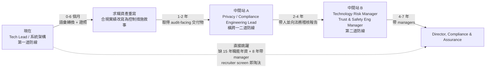

# Meta - Director, Compliance & Assurance

> ## 評估摘要 (Evaluation Summary)
>
> `評估日期`: 2026-09-10, 對照 [Resume.md](../../Resume.md)
>
> `匹配度 (Profile Matching Score)`: `28 / 100`
>
> `結論`: 這是一檔`第二道防線 (second line of defense)` 的組織領導職, 不是工程職. 履歷手上握有大量`第一道防線`的合規實作資產 (EU 資料遷移, change-region 合規框架, 醫療業與錢包業的受監管年資), 但 JD 要的是`監督, 保證與對外代表`那一側, 且要求 15 年 GRC 年資與 8 年帶 manager 的紀錄, 兩條硬門檻都未達. 本檔的價值不在投遞, 在於`它標定了一條把合規實作經驗變現的路徑`, 而該路徑的下一步不是這個職缺.
>
> `符合的部分`:
>
> - `Bachelor's degree or practical experience equivalent`: 具 M.S. in Computer Science, 唯一完整命中的硬性要求.
> - `5+ years working in regulated industries or security (加分)`: Change Healthcare 美國醫療 4.5 年加上 TikTok 錢包 3.5 年, 共 8 年落在受監管領域, 這一條超額.
> - `Experience working in Tech, and using AI tools to improve workflows, strengthen controls (加分)`: 2026 年起的跨 provider Agent SDK 與多模型編排, 對上 JD 反覆強調的`用 AI 擴充評估產能`, 是履歷少數比多數 GRC 候選人更強的一條.
> - `Advanced degree (加分)`: 碩士達標, 但缺 `CISSP / CISA / CRISC` 這類 GRC 專業證照, 只有 AWS SAA.
> - `Experience delivering assurance against external regulatory frameworks (部分)`: TikTok 的 EU 資料遷移與 change-region 合規一致性是 GDPR 驅動的, Change Healthcare 是 HIPAA 環境並處理過 Fortify 弱點與 KMS 金鑰管理. 但這些是`被稽核方的交付`, 不是`稽核與保證方的報告`, 只能算部分覆蓋.
> - `Cross-functional alignment (部分)`: change-region 框架被錢包以外的業務線採用, 具跨部門推動的事實, 但對話層級是工程與 PM, 不是 Board 與 regulator.
>
> `不符合的部分`:
>
> - `15+ 年領導 security / technology risk / GRC / trust & safety 職能`: 總年資 12+ 年已不足, 且`從未在該職能內任職`, 更未領導過. 這是雙重未達, 不是年資差三年而已.
> - `8+ 年帶團隊並管理 managers`: 履歷帶人紀錄是 Change Healthcare 的 5 人, 約 4.5 年, 且是帶工程師不是帶 manager. Director 這一級要的是`帶管理者`, 中間隔了 Manager 與 Senior Manager 兩級.
> - `作為 tech risk 或 second line of defense 與產品/基礎設施組織對接`: 履歷全部位於`第一道防線`, 也就是被監督的那一方. 這是本檔最關鍵的軌道錯位, 詳見缺口分析.
> - `全球內容法規, 內容審核與 Trust & Safety`: 零舉證. JD 明列 Integrity, Youth, Privacy & Security 四大法規面, 履歷只碰過 Privacy 一面.
> - `向 Board, 委員會, 監管機關與外部稽核代表公司`: 零舉證, 且這是 JD 唯一標明為`最終風險承擔升級點`的職責.
> - `管理專案財務, 預算與資源配置`: 零舉證.
> - `AI 風險評估方法論 (predicate / model / rapid assessment 的分級與作業協定)`: 有 AI 工程能力, 無 AI 治理方法論的建置經驗.
> - `工作地點與工作權`: 職缺在 Menlo Park, CA. 履歷是新加坡 PR 與台灣籍, 需 H-1B 或 L-1; Director 級外部直聘搭配簽證贊助的機率極低.
>
> `投遞前必問`:
>
> - `+ 1 more` 的第二個地點是哪裡, 是否含新加坡或都柏林. 若含新加坡, 工作權問題消失, 但年資與軌道缺口不變.
> - 這個 Director 對標的內部職等是 M2 還是 D1, 以及底下實際有幾位 manager.
> - `New Product Compliance for AI` 這條主軸的交付物是`治理流程`還是`工程平台`. 若實際上是後者 (用 AI 建監控與證據自動化), 履歷的相關性會顯著上升, 但職稱仍不會給到 Director.
> - RCP 組織內是否另有 `Compliance Engineering` 或 `Privacy / Integrity Engineering` 的工程職缺, 那才是履歷該投的入口.

## 基本資訊 (Basics)

| 項目 | 內容 |
| --- | --- |
| 公司 (Company) | Meta (Facebook, Instagram, WhatsApp, Messenger 母公司) |
| 職稱 (Title) | Director, Compliance & Assurance |
| 部門 (Department) | Program Management / Regulatory Compliance Programs (RCP) |
| 角色類型 (Role Type) | `director` · `internal` · `security` |
| 地點 (Location) | Menlo Park, CA, 美國 (職缺頁另標 `+ 1 more`) |
| 職缺編號 (Job Post ID) | `1728142584963155` |
| 原始連結 (Original Link) | <https://www.metacareers.com/profile/job_details/1728142584963155/> |
| 薪酬 (Package) | `USD 227,000 - 287,000 / 年` 基本薪, 另加 bonus, equity 與福利 |
| 最低年資 (Min Experience) | `15 年以上` (另需 `8 年以上`帶團隊) |
| 學歷要求 (Min Qualification) | 學士或同等實務經驗 |
| 投遞狀態 (Status) | `not_applied` (更新於 2026-09-10) |
| 抓取日期 (Fetched) | 2026-09-10 (JD 全文由人工貼入, metacareers 對非瀏覽器請求回 HTTP 400) |

## 團隊背景 (Team Context)

`Regulatory Compliance Programs (RCP)` 自述為 Meta 風險管理與合規的`中央引擎`, 服務 Meta 本體與整個 family of apps. 三項使命依序為: 讓業務`以規模與速度`達成目標, 抵禦真實世界的安全風險, 以及回應公司面對的監管審視. 團隊的自我定位是`讓 Meta 成為 GRC 與 Integrity 專業人士的首選雇主`.

本職位所領導的 `Compliance & Assurance` 組正在`快速擴編`, 三條策略主軸為: `新產品合規` (涵蓋 AI 與一般產品上線), `新增義務的加速緩解`, 以及`建立整合式報告以支撐高層決策`.

## 崗位職責 (Responsibilities)

- 主導 Compliance & Assurance 的`策略, 運作模式與執行`, 含 New Product Compliance, Compliance Effectiveness 與跨專業團隊.
- 與 Central Product Leads 合作落實降風險措施 (整合式監控, 報告與監督).
- 把合規評估`嵌進產品生命週期的早期`, 使緩解措施前置並加速安全上線.
- 以 `AI 擴充合規效能`: 交付監控, 監督, 稽核證據 (artefacts) 與組織級的持續改善.
- 維持對 `Integrity, Youth, Privacy & Security` 四大監管面向的深度理解, 並據以設計合規策略與優先序.
- 向`高層, 董事會, 各委員會, 監管機關與外部稽核`代表 Meta 的合規態勢, 並擔任`風險接受決策的最終升級點`.
- 依對象 (工程, 產品, 法務) 調整`高度與媒介`, 把複雜技術概念說清楚以促成跨職能對齊與決策.
- 辨識策略, 產品或立場中的`關鍵缺口與風險`, 並設計策略性緩解方案.
- 建立`端到端的 AI 風險評估能力`: 與 AI Infra, 產品與法務共同定義方法論, 分級 (tiering), 以及 predicate, model, rapid 三類評估的作業協定.
- 領導 Privacy, Integrity, Legal, Compliance 與 Internal Audit 的`跨領域對齊`, 落實監督模型.
- 管理專案財務, 預算與資源, 同時推動 AI 與自動化以`在不犧牲可辯護性的前提下`擴充評估產能.

## 任職要求 (Requirements)

`硬性要求 (Must-have)` — 原文 `Minimum Qualifications`:

- `15 年以上`領導 `security, technology risk, GRC 或 trust & safety` 職能 (或相關領域) 的經驗.
- `8 年以上`管理與培養團隊的經驗, 含`管理 managers 或資深 IC`, 並有明確晉升至組織領導層的軌跡.
- 培養人才與領導者, 在成長或變動中`維護組織健康`的經驗.
- 與`高層主管`協作與施加影響, 形塑組織策略, 影響優先序, 推動跨職能 (XFN) 對齊.
- 以 `tech risk 或第二道防線 (second line of defense)` 的身分, 直接與產品, 基礎設施或工程組織對接.
- 學士學位, 或等同於高等教育課程的實務經驗.
- 對`外部監管或認證體系`交付保證 (assurance) 或報告的經驗, 例如 `EU / 全球監管框架, SOC 2, HIPAA, FDA, 美國政府要求`.

`加分要求 (Preferred)` — 原文 `Preferred Qualifications`:

- 進階學位, 或相關專業證照.
- 熟悉`全球內容法規, 內容審核 (content moderation) 與 trust & safety` 最佳實務.
- `5 年以上`在受監管產業或資安領域的工作經驗.
- 具科技業經驗, 並`運用 AI 工具改善工作流, 強化控制措施並促成合規`.

`其他條件 (Other)`:

- 工作地點 Menlo Park, CA; 加州職缺另有 pay transparency 附加說明.
- 薪酬揭露: `USD 227,000 - 287,000 / 年`, 僅為基本薪, 不含 bonus, equity 與銷售獎金.
- Meta 為 Equal Employment Opportunity 雇主, 並提供身心障礙者的申請流程協助.
- 職缺頁標示 `+ 1 more` 的其他地點, 實際可選地點需於流程中確認.

## 缺口分析 (Gap Analysis)

### 先確認手上已有的槓桿 (Transferable Assets)

| 履歷事實 | 對應到 JD 的哪一句 | 強度 |
| --- | --- | --- |
| TikTok `EU 資料遷移` 並一般化為 global change-region 合規 | `EU / 全球監管框架`的交付 | `高`. 這是真實的跨國法規落地, 不是紙上流程 |
| TikTok 定義 `data SDLC`, 使 residency 與 retention 成為生命週期屬性 | `把合規評估嵌進產品生命週期早期` | `高`. 概念完全同構, 差別只在他做的是`實作側` |
| change-region 框架被錢包以外業務線採用 | `跨領域對齊`, `組織級持續改善` | `中高`. 有跨部門採用的事實 |
| Change Healthcare 美國醫療 4.5 年 (HIPAA 環境), 處理 Fortify 弱點, Jenkins KMS | `HIPAA`, `受監管產業 5 年以上` | `中高`. 但角色是修補方, 非保證方 |
| 2026 年跨 provider Agent SDK 與多模型編排 | `以 AI 擴充合規效能`, `AI 風險評估能力` | `中高`. 工程能力強, 治理方法論為零 |
| Change Healthcare 帶 5 人, 30+ 輪面試 | `8 年以上帶團隊, 含帶 managers` | `低`. 規模與層級都差一截 |
| TSMC 技術專案經理: 拆任務, 訂排程, 對齊商業需求 | `管理專案財務, 預算與資源` | `低`. 有排程無預算 |
| AWS SAA 證照 | `相關專業證照` | `極低`. GRC 側認的是 CISA / CRISC / CISSP |

`關鍵判讀`: 履歷在`合規的實作內容`上覆蓋率意外地高, 在`合規的職能身分`上覆蓋率是零. 這是`同一個領域, 相反的位置` -- 他一直是被稽核的那一方.

### 缺口一: 第一道防線 vs 第二道防線 (軌道級, 也是唯一真正的關卡)

`缺什麼`: 企業風險治理的`三道防線 (Three Lines of Defense)` 模型中, 第一道是`業務與工程自己承擔並管理風險`, 第二道是`獨立的風險與合規職能, 訂標準, 監督, 挑戰並保證`, 第三道是內部稽核. 履歷的所有合規資產 -- EU 遷移, data SDLC, change-region 框架 -- 全部生成於第一道防線. JD 這一條寫的是 `as a tech risk or second-line of defense`.

`缺了會怎樣`: 兩者的產出物根本不同. 第一道防線交付`可運作的系統`; 第二道防線交付`可辯護的證據與判斷`, 而且必須在自己不擁有系統的情況下逼系統改變. 面試會直接追問`你曾經否決過哪個產品上線`, 履歷目前無法回答, 因為他從來站在被否決的那一側. 這條缺口`不是靠年資累積會自動消失的`, 它需要一次職能轉換.

`怎麼補`: `不能自學`. 唯一路徑是先取得一個`橫跨兩道防線`的職位 -- Privacy Engineering Lead, Data Governance Lead, 或 Compliance Engineering Manager. 這類職位仍然寫程式, 但產出物開始是`控制措施與證據`, 對象開始是法務與稽核. 從那裡才有可能橫移到純第二道防線.

### 缺口二: Director 級的組織幅度 (門檻級)

`缺什麼`: `8 年以上帶團隊且管理 managers`. 履歷是 5 人約 4.5 年, 帶的是工程師. Director 之下通常有 2 至 4 位 manager 與 20 至 60 人.

`缺了會怎樣`: 這條與缺口一疊加後, 履歷會在 recruiter screen 被過濾, 不會進到面試. JD 特別加了 `demonstrated progression into organizational leadership` 這句, 意思是他們要看的是`晉升軌跡`本身, 而履歷最近一段 (2026/06 起) 是 self-directed, 軌跡呈現的是`離開組織`而非`向上`.

`怎麼補`: 只能靠時間與實職. 以每級 2 至 3 年計, Tech Lead 到 Director 是 4 至 7 年, 且必須在同一條軌道上連續累積.

### 缺口三: 內容法規與 Trust & Safety 領域

`缺什麼`: `Integrity, Youth, Privacy & Security` 四面中, 履歷只有 Privacy 一面, 且是資料落地面的 Privacy, 不是內容面的. 完全沒有 content moderation, 未成年人保護, DSA 或 Online Safety Act 這類法規的接觸.

`缺了會怎樣`: 這是 preferred 不是 minimum, 單獨不致命. 但它決定了`能不能在面試中把話講到對的高度` -- Director 要能在董事會層級判斷`哪一條法規對哪一個產品構成實質風險`, 而不只是`怎麼把資料搬到歐盟`.

`怎麼補`: `可自學, 成本中等`. `EU DSA`, `EU AI Act`, `UK Online Safety Act`, `COPPA` 與各國未成年人法規是有限且公開的教材. 三個月密集閱讀可以取得對話能力, 但取得不了判例經驗.

### 缺口四: 工作權與地點

`缺什麼`: 職缺在 Menlo Park, 需美國工作權. 履歷是新加坡 PR 與台灣籍.

`缺了會怎樣`: Director 級的外部直聘同時要求簽證贊助, 在現行 H-1B 抽籤與費用環境下, 實務上等於不可行. `+ 1 more` 的第二地點是本檔唯一可能翻盤的變數.

`怎麼補`: 唯一實務路徑是 `L-1 內部調動` -- 先在 Meta 新加坡或都柏林任職滿一年, 再申請調往美國. 這反過來說明了為什麼下一步應該投 Meta 的`工程職`而不是這一檔.

### 路徑圖 (Roadmap to This Role)

| 階段 | 時程 | 目標職位 | 這一步要拿到的東西 | 現在就能開始的動作 |
| --- | --- | --- | --- | --- |
| `階段 0` | 0-6 個月 | 不換工作 | 語彙與證照 | 把 EU 遷移與 change-region 框架改寫成`控制措施, 證據鏈與可辯護性`的敘事; 考 `CISA` 或 `CRISC` (兩者都不要求現職為稽核) |
| `階段 1` | 1-2 年 | Privacy Engineering Lead, Data Governance Lead, Compliance Engineering Manager | 第一份 `audit-facing` 交付物: 為 SOC 2 或 ISO 27001 產出證據並直面外部稽核 | 在本庫主動搜尋這三個關鍵字; Airwallex 與 OKX 的 IAM / 平台安全職缺是最近的入口 |
| `階段 2` | 2-4 年 | Technology Risk Manager, GRC Manager, Trust & Safety Engineering Manager | 職能身分正式轉為第二道防線; 開始帶人; 第一次向法務或董事會層級報告 | 需要階段 1 的稽核交付物作為履歷憑證, 無法跳過 |
| `階段 3` | 4-7 年 | Head of / Senior Manager, Compliance Engineering | 帶 managers, 管理預算, 對監管機關發言 | -- |
| `終點` | 7 年以上 | Director, Compliance & Assurance | -- | -- |

`這條路徑上唯一的捷徑`: JD 有一條與眾不同的主軸 -- `以 AI 擴充合規效能, 交付監控, 監督與稽核證據`. 這條是`新的`, 市場上沒有人有 15 年年資, 因為這個問題三年前不存在. 履歷在 AI 編排上的存貨遠高於典型 GRC 候選人. 若要壓縮路徑, 唯一的槓桿是`做出一個 AI 驅動的合規證據自動化作品並公開`, 讓自己以`懂 AI 的合規工程師`身分進入階段 1, 而不是以`想轉行的後端工程師`身分.

### 角色地圖 (Role Map)

| 面向 | 這個角色要的 | 履歷目前位置 | 距離 |
| --- | --- | --- | --- |
| 防線位置 | 第二道防線 (監督與保證) | 第一道防線 (建置與交付) | `遠` |
| 產出物 | 可辯護的判斷, 證據與報告 | 可運作的系統與框架 | `遠` |
| 組織幅度 | 帶 managers, 20-60 人 | 帶 5 位工程師 | `遠` |
| 對話對象 | 董事會, 監管機關, 外部稽核 | 工程師, PM, 跨部門 owner | `遠` |
| 法規領域 | Integrity, Youth, Privacy, Security | Privacy (資料落地面) 一面 | `中` |
| 受監管環境的浸泡 | 必要 | 8 年 (醫療 + 錢包) | `近 (這是優勢)` |
| AI 用於合規 | 策略主軸之一 | 工程能力強, 治理方法論零 | `中 (這是機會)` |

`判讀`: 七個面向有四個是`遠`, 且四個都集中在`職能身分`而非能力. 距離不是`兩步`, 是`一次轉軌加兩級`.

## 我的對位敘事 (Positioning Angle)

`不投遞`. 硬性要求七條中未達四條, 其中兩條是年資型硬門檻, 一條是職能身分, 加上美國工作權, 沒有任何敘事角度能覆蓋. 但這一檔應`留檔並列為方向標`, 理由有三:

`一, 它把履歷中被低估的一段重新定價`. 在純工程職缺裡, `EU 資料遷移` 只是`分散式系統與資料治理`的一個註腳; 在這一檔裡, 它是 `delivering assurance against EU regulatory frameworks` 的核心資格. 同一段經歷在 GRC 軌道上的定價高出許多. 這個發現應立即回收到其他職缺的敘事: 凡是提到 TikTok 那段, 都應把`合規`這個詞放到句首而不是句尾.

`二, 中間站才是該投的`. 若對這條路徑有興趣, 正確的下一步關鍵字是 `Privacy Engineering`, `Compliance Engineering`, `Data Governance` 與 `Technology Risk` -- 這些職位同時接受工程背景, 又能累積 audit-facing 的交付物. 本庫目前一檔都沒有, 應在下一輪蒐集補上.

`三, Meta 的正確入口不是這一檔`. 若目標是 Meta, 履歷該投的是本庫已有的 [Forward Deployed Engineer, Enterprise AI (Senior)](forward_deployed_engineer_senior.enterprise_ai.md) 與 [Software Engineer, Product (Singapore)](software_engineer_product.singapore.md) -- 新加坡在地, 工作權無虞, 且進去之後 `L-1 內部調動`與`內轉 RCP` 兩條路才會打開. 以`外部直聘 Director`為起點, 是把七年的路徑壓縮成一次申請, 不會成立.

`若情況改變`: 唯一值得重新評估的觸發條件是 `+ 1 more` 的第二地點為新加坡, `且`職缺實際對標的是 `Compliance Engineering` 而非 GRC 管理. 屆時應以`用 AI 建立合規證據自動化`為單一切入角重新計分.
